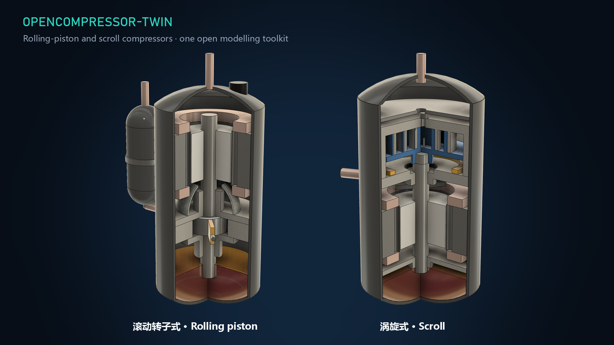

# OpenCompressor-Twin

[ **English** | [简体中文](README.zh-CN.md) ]

[](https://github.com/wangzhichao-jpg/opencompressor-twin/actions/workflows/ci.yml)
[](LICENSE)
[](pyproject.toml)
[](https://www.bilibili.com/video/BV12Xnw6TEY2/)
[](https://youtu.be/IrX2Fq-NGEU)

**One open, reproducible toolkit for positive-displacement refrigerant compressors: calibrate a performance model from measured points, predict untested conditions with an explicit validity domain, compare honestly against industry baselines, and choose the next test point.**

Repositories: [GitHub](https://github.com/wangzhichao-jpg/opencompressor-twin) · [Gitee mirror](https://gitee.com/bigtaurus/opencompressor-twin)



> **Status: research preview (0.1.0a1).** The scroll workflow has been tested on published calorimeter data from two compressor models. The rolling-piston model is implemented and software-tested, but **has not yet been validated against measured rolling-piston data**. Read the [validation report](docs/validation.md) before relying on any number.

## What it does

```text
measured points ─▶ unit / boundary / provenance checks ─▶ compressor model (rolling piston | scroll)
               ─▶ grouped calibration ─▶ prediction + domain check (+ optional conformal interval)
               ─▶ next-test recommendation ─▶ frozen benchmark against baselines ─▶ offline HTML report
```

- **One package, one CLI** (`octwin`) for both structures; the structure is chosen by metadata, not by a separate program.
- **SI units, absolute pressure, explicit power boundary.** Shaft power is never relabelled as electrical input; speed provenance (measured vs. nominal-equivalent) is recorded.
- **Grouped data handling.** Repeated tests of one nominal condition share a group and never straddle train/calibration/test sets.
- **Conservative domain.** Points outside the convex hull of the training inputs are refused rather than silently extrapolated.
- **Baselines are first-class.** Every benchmark also fits a training-only affine surface and an AHRI-540-style ten-coefficient cubic in dew temperatures.
- **Optional explicit residual extension** (`--residual-rbf`): a radial-basis log-residual correction on top of the physical model, stored and validated as a separate layer.
- **Test-point recommendation**: coverage (maximin), local D-optimal parameter information, or full-input kernel variance reduction, each with relative cost.
- **Frozen-protocol evaluation tools**: fixed-budget learning curves, select-reveal-recalibrate replay, and development-only cross-validation that cannot see held-out labels.

## Validation summary

Held-out measured points, mean absolute relative error (MARE). Full tables, P95/max errors, intervals and caveats: [docs/validation.md](docs/validation.md).

| Dataset (published experiment) | Test points | Four-parameter model | Four-parameter + RBF | AHRI-style 10-coefficient |
|---|---:|---|---|---|
| Copeland ZP21K5E-PFV, R410A, 65°F suction (AREP #11) — **protocol frozen before data download** | 12 | 1.40% / 2.80% | 0.36% / 0.26% | **0.29% / 0.14%** |
| Copeland ZP21K5E-PFV, R32, 65°F suction (AREP #11) — **protocol frozen before data download** | 10 | 1.24% / 2.22% | **0.24% / 0.47%** | 0.23% / 0.48% |
| Copeland ZS21KAE-PFV, R404A, 65°F suction (AREP #21) | 12 | 0.62% / 1.71% | not scored on this set | **0.41% / 0.16%** |

Values are mass flow / electrical power. What this shows:

- The physical four-parameter model meets a 5% MARE / 10% P95 target on these sets, but at **fixed speed and fixed suction temperature, inside the training domain, the ten-coefficient polynomial is clearly better**.
- The RBF residual extension consistently improves the physical model and is **roughly on par with** the ten-coefficient baseline (slightly worse for R410A, slightly better for R32). It adds coefficients; it is not a "four parameters only" result.
- None of the recommendation strategies showed a consistent advantage over simple maximin coverage. **No reduction in test points or bench time is claimed.**
- Not yet tested: rolling-piston measurements, cross-speed prediction, boundary extrapolation, independent laboratories.

## Quick start

Python 3.11–3.14. Use an isolated environment.

```bash
python -m venv .venv
# Windows: .venv\Scripts\activate    POSIX: source .venv/bin/activate
pip install -e ".[test]"
pytest -q
octwin demo --output runs/demo          # synthetic software self-test for both structures
```

Benchmark a published dataset with its frozen split:

```bash
octwin benchmark data/public/arep11_r410a_65f/data.csv \
  --meta data/public/arep11_r410a_65f/metadata.json \
  --split data/public/arep11_r410a_65f/split.json \
  --output runs/arep11_r410a
# open runs/arep11_r410a/report.html
```

Calibrate, predict and recommend with your own data:

```bash
octwin validate data.csv --meta metadata.json
octwin calibrate data.csv --meta metadata.json --split split.json --output model.json
octwin predict --model model.json --conditions inputs.csv --output predictions.csv
octwin recommend --model model.json --candidates candidates.csv --strategy kernel_ivr --budget 3 --approved --output next.json
```

```python
from octwin.api import load_dataset, build_artifact, predict_point

dataset = load_dataset("data.csv", "metadata.json")
model = build_artifact(dataset, dataset.observations)   # in a real study pass training groups only
print(predict_point(model, dataset.observations[0].point))
```

## Data format

Observation CSV (SI units, absolute pressure):

```text
point_id,group_id,suction_pressure_pa,discharge_pressure_pa,suction_temperature_k,speed_rpm,mass_flow_kg_s,power_w
```

Metadata JSON declares `compressor_type` (`rolling_piston` | `scroll`), refrigerant, displacement, `power_boundary`, `speed_definition`, `source_kind` and source/licence. Candidate CSVs for recommendation contain inputs only. See the [user guide (中文)](docs/user-guide.zh-CN.md) and an empty template in `data_templates/`.

## Models in brief

`m = ρ_s · V_d · N/60 · η_v`, `P = m · Δh_s / η_is`, with bounded four-parameter correlations for volumetric and isentropic efficiency; the pressure-ratio term differs by structure (rolling piston: `PR − 1`, scroll: `ln PR`). Thermophysical properties come from CoolProp; suction states must be single-phase vapour. Speed currently enters throughput only — **speed-dependent losses are not modelled**, which is the main known physical limitation.

## Reproducibility

- `data/public/` — published datasets with metadata, frozen splits and extraction audits; `data_sources/` — cell-by-cell transcriptions; `tools/prepare_*.py` — conversions (original reports are not redistributed; download them from the URLs in the metadata).
- `evidence/` — frozen result files. `tools/regression_check.py` recomputes them and requires exact equality.
- `data_sources/round5_external_protocol.json` and `round5_protocol_freeze.json` record the protocol and code hashes fixed before the AREP #11 data were downloaded.

## Contributing data

Measured rolling-piston (and scroll) data with paired mass flow and compressor power are the most valuable contribution. Please read [CONTRIBUTING.md](CONTRIBUTING.md); data from any manufacturer is welcome when the source, units, power boundary and licence are clear.

## Author and citation

Project lead: [Zhichao Wang](https://github.com/wangzhichao-jpg) (ORCID [0000-0001-6662-835X](https://orcid.org/0000-0001-6662-835X)).
If you use this software in a paper or an engineering report, please cite it as described in [CITATION.cff](CITATION.cff) (the **Cite this repository** button on GitHub exports BibTeX/APA). If it is useful to you, a star on GitHub or [Gitee](https://gitee.com/bigtaurus/opencompressor-twin) helps other engineers find it. Questions, bug reports and public data: [Issues](https://github.com/wangzhichao-jpg/opencompressor-twin/issues).

Cooperation and enquiries: [wangzhichao@chinaibee.com](mailto:wangzhichao@chinaibee.com)

## License

Original code: [MIT](LICENSE), © 2026 Jianke Environment and Energy Technology Co., Ltd. Dependencies: [THIRD_PARTY_NOTICES.md](THIRD_PARTY_NOTICES.md). Datasets keep their own terms and attribution: [DATA_LICENSES.md](DATA_LICENSES.md).
